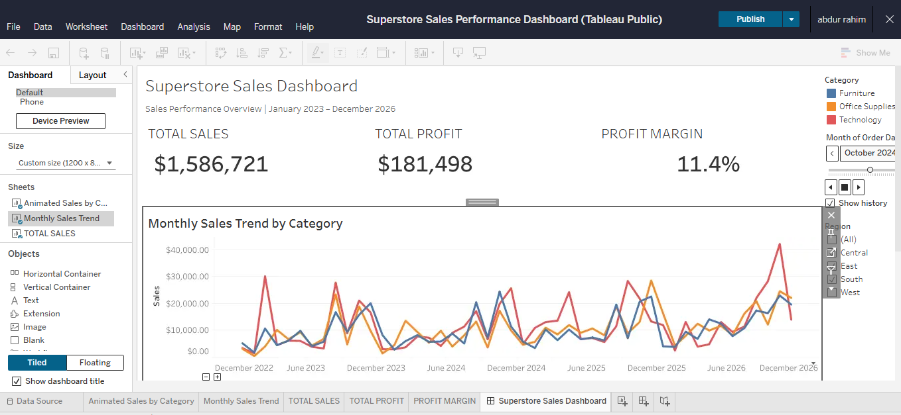
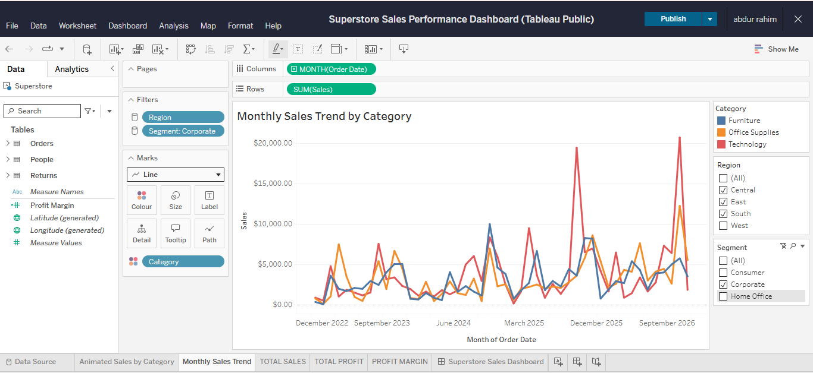
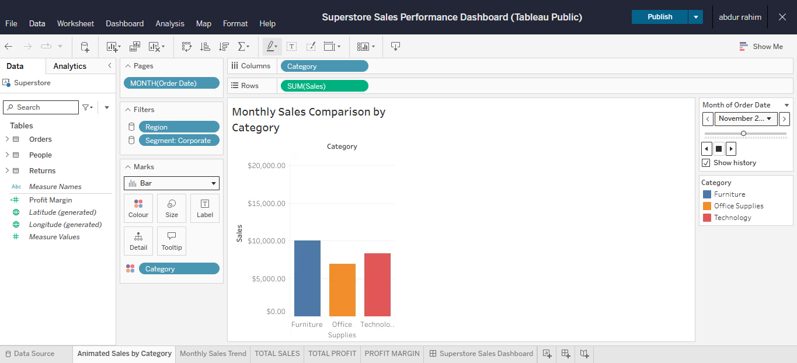

# Superstore Sales Performance Dashboard

An interactive Tableau dashboard designed to analyze Superstore sales performance, profitability, and monthly sales trends.

## Project Overview

This project explores the Sample Superstore dataset to identify sales patterns, compare product category performance, and monitor business profitability through interactive visualizations.

The dashboard provides a consolidated view of key business performance indicators and allows users to explore sales trends over time.

## Dashboard Preview



**Key Performance Indicators (KPIs):**
- Total Sales
- Total Profit
- Profit Margin

*Displayed KPI values depend on the selected dashboard filters.*

## Dashboard Features

### 1. Monthly Sales Trend by Category



- Visualizes monthly sales trends across Furniture, Office Supplies, and Technology.
- Compares category performance over time.
- Includes interactive tooltips.

### 2. Animated Sales Comparison by Category



- Uses Tableau Pages to animate monthly sales comparisons.
- Shows how category sales change over time.
- Supports interactive exploration of monthly performance.

### 3. Interactive Filters

- Region filter
- Segment filter
- Month of Order Date control
- Category legend

These controls allow users to explore different business dimensions and analyze performance under different filter selections.

## Tools & Techniques

- Tableau Public
- Data Visualization
- Interactive Dashboard Development
- Calculated Fields
- KPI Development
- Time-Series Analysis
- Filters and Parameters
- Data Analysis

## Project Files

```text
superstore-sales-tableau-dashboard/
│
├── Dashboard/
│   ├── Superstore_Sales_Dashboard.twbx
│   └── README.md
│
├── Images/
│   ├── dashboard-overview.PNG
│   ├── monthly-sales-trend.PNG
│   └── animated-sales-category.PNG
│
└── README.md
```

## Live Dashboard

[View Interactive Dashboard on Tableau Public](https://public.tableau.com/app/profile/abdur.rahim5381/viz/SuperstoreSalesPerformanceDashboard_17952461517660/SuperstoreSalesDashboard)

## Project Type

Independent learning and portfolio project.

**Objective:** Apply Tableau skills to develop an interactive business intelligence dashboard and communicate sales performance through data visualization.
